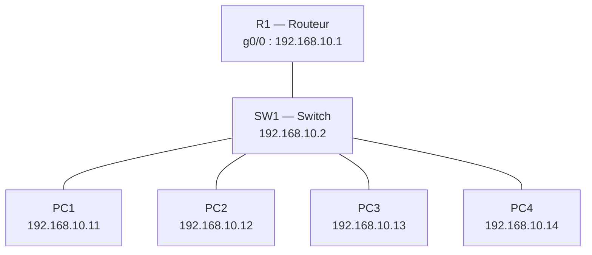

# Projet 1 — Câblage et adressage IP d'un petit bureau

---

## 1. Contexte

Un bureau de **4 postes** doit être câblé et adressé en **IP statique** sur un **même sous-réseau**, avec un switch central et un routeur (passerelle).

## 2. Objectifs pédagogiques

-  Concevoir un plan d'adressage IP cohérent
-  Câbler et connecter switch / routeur / postes
-  Vérifier la connectivité de bout en bout

---

## 3. Prérequis

- GNS3 installé (GUI + serveur local ou GNS3 VM)
- Un appliance **routeur** (ex. Cisco c7200 / c3745 avec IOS, ou **VPCS** + routeur au choix)
- Un **switch** : *Ethernet switch* intégré à GNS3 (le plus simple) ou switch Cisco IOSvL2
- **4 postes** : nœuds **VPCS** (légers, idéal pour débuter)


---

## Étape 1 — Définir le plan d'adressage

### 1.1 Choix du sous-réseau

| Paramètre | Valeur |
|-----------|--------|
| Réseau | `192.168.10.0` |
| Masque | `255.255.255.0` (`/24`) |
| Adresse de broadcast | `192.168.10.255` |
| Passerelle (routeur) | `192.168.10.1` |
| Plage utilisable | `192.168.10.1` – `192.168.10.254` |
| Hôtes possibles | 254 (largement suffisant pour 4 postes + équipements) |

### 1.2 Table d'adressage

| Équipement | Interface | Adresse IP | Masque | Passerelle |
|------------|-----------|------------|--------|------------|
| Routeur R1 | `f0/0` (ou `g0/0`) | `192.168.10.1` | `255.255.255.0` | — |
| Switch SW1 | VLAN 1 (gestion, optionnel) | `192.168.10.2` | `255.255.255.0` | `192.168.10.1` |
| PC1 | `eth0` | `192.168.10.11` | `255.255.255.0` | `192.168.10.1` |
| PC2 | `eth0` | `192.168.10.12` | `255.255.255.0` | `192.168.10.1` |
| PC3 | `eth0` | `192.168.10.13` | `255.255.255.0` | `192.168.10.1` |
| PC4 | `eth0` | `192.168.10.14` | `255.255.255.0` | `192.168.10.1` |
:::success
**Logique du plan** : `.1` = passerelle, `.2–.9` = équipements réseau, `.11–.14` = postes (PC1 → `.11`, etc.). Cela facilite la lecture et laisse de la place pour évoluer.
:::

---

## Étape 2 — Câbler les équipements dans GNS3

### 2.1 Créer le projet

1. Ouvrir GNS3 → **File → New blank project**
2. Nom : `Projet1_Bureau_4postes`

### 2.2 Placer les équipements

1. Glisser **1 routeur** (R1) dans l'espace de travail
2. Glisser **1 switch** (SW1)
3. Glisser ** VPCS** et les renommer `PC1` … `PC4` (clic droit → *Change hostname*)

### 2.3 Tirer les câbles

Utiliser l'outil **Add a link** (icône câble) :

| Lien | De | Vers |
|------|----|------|
| 1 | R1 `g0/0` | SW1 `e0` |
| 2 | PC1 `e0` | SW1 `e1` |
| 3 | PC2 `e0` | SW1 `e2` |
| 4 | PC3 `e0` | SW1 `e3` |
| 5 | PC4 `e0` | SW1 `e4` |

### 2.4 Démarrer la topologie

- Cliquer sur le bouton **▶ Start all devices**
- Attendre que tous les points deviennent **verts**

```text
              [ R1 ]
                |
                | g0/0 .1
            [ SW1 ]
   ┌───┬───┬───┼
  PC1 PC2 PC3 PC4 
 .11 .12 .13 .14 
```

---

## Étape 3 — Configurer les IP statiques

### 3.1 Configurer le routeur R1

Ouvrir la console (double-clic sur R1) :

```cisco
enable
configure terminal
hostname R1
interface g0/0
 ip address 192.168.10.1 255.255.255.0
 no shutdown
 description LAN-Bureau
exit
end
write memory
```

Vérifier :

```cisco
show ip interface brief
```


### 3.2 Configurer chaque poste (VPCS)

Ouvrir la console de chaque PC et saisir :

**PC1**
```text
ip 192.168.10.11 255.255.255.0 192.168.10.1
save
```


**PC2**
```text
ip 192.168.10.12 255.255.255.0 192.168.10.1
save
```


**PC3**
```text
ip 192.168.10.13 255.255.255.0 192.168.10.1
save
```


**PC4**
```text
ip 192.168.10.14 255.255.255.0 192.168.10.1
save
```


Vérifier sur chaque poste :

```text
show ip
```


### 3.3 (Optionnel) Switch Cisco IOSvL2

Si vous utilisez un switch Cisco et non le switch intégré :

```cisco
enable
configure terminal
hostname SW1
interface vlan 1
 ip address 192.168.10.2 255.255.255.0
 no shutdown
exit
ip default-gateway 192.168.10.1
end
write memory
```

---

## Étape 4 — Tester la connectivité

### 4.1 Test poste → passerelle

Depuis **PC1** :

```text
ping 192.168.10.1
```


### 4.2 Test poste → poste (matrice complète)

Depuis **chaque poste**, pinguer **les 3 autres** :

```text
ping 192.168.10.11
ping 192.168.10.12
ping 192.168.10.13
ping 192.168.10.14
```

### 4.3 Matrice de test à remplir

Cocher ✅ quand le ping réussit (5/5 réponses) :

| De \ Vers | PC1 | PC2 | PC3 | PC4 | R1 |
|-----------|-----|-----|-----|-----|----|
| **PC1** | — | ✅ | ✅ | ✅ | ✅ |
| **PC2** | ✅ | — | ✅ | ✅ | ✅ |
| **PC3** | ✅ | ✅ | — | ✅ | ✅ | 
| **PC4** | ✅ | ✅ | ✅ | — | ✅ | 

### 4.4 Captures réaliser (preuves)


### 4.5 Dépannage rapide

| Symptôme | Cause probable | Correction |
|----------|----------------|------------|
| `host unreachable` | Mauvais masque ou IP en double | Vérifier `show ip` sur chaque poste |
| Ping vers R1 échoue | Interface R1 en `shutdown` | `no shutdown` sur `g0/0` |
| Aucun ping entre postes | Équipements non démarrés / lien rouge | Relancer **Start all devices** |
| Ping partiel | Postes dans des sous-réseaux différents | Contrôler les 3 premiers octets |
| IP perdue au redémarrage | Config non sauvegardée | Taper `save` sur VPCS |

---

## Étape 5 — Documenter le schéma réseau

### 5.1 Capture du schéma GNS3

1. Aligner proprement les équipements dans GNS3
2. **Ajouter des annotations** (icône `T` / *Add a note*) :
   - Nom du réseau : `LAN Bureau — 192.168.10.0/24`
   - IP de chaque équipement à côté de son icône
   - Numéros d'interface sur chaque lien (`g0/0`, `e1`, etc.)
3. Activer l'affichage des **noms d'interface** : *View → Show/Hide interface labels*


### 5.2 Schéma textuel


---