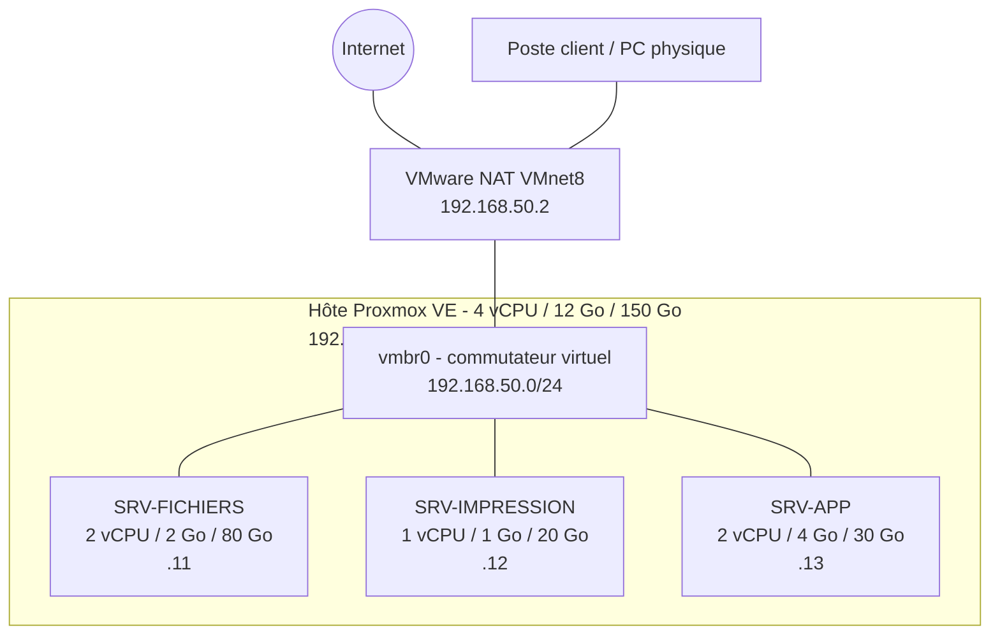

---

# Projet 1 — Infrastructure virtuelle pour une PME

## 1. Contexte et objectif

Une PME de **15 salariés** possède 3 serveurs physiques (fichiers, impression, applicatif). Elle souhaite les **virtualiser sur un seul hôte** pour réduire ses coûts matériels (achat, énergie, maintenance).

**Livrables attendus :**

-  Les 3 VM opérationnelles
-  Un schéma d'architecture (réseau + ressources)
-  Une fiche de configuration par VM

## 2. Choix de l'hyperviseur

| Critère | Proxmox VE | VMware ESXi | Hyper-V |
|---|---|---|---|
| Licence | Gratuit (open source) | Gratuit limité / payant | Inclus dans Windows Server |
| Interface | Web (port 8006) | Web (HTTPS) | Gestionnaire Hyper-V |
| Idéal pour PME | Oui (coût nul) | Oui (écosystème) | Si parc Windows |

## 3. Dimensionnement

### 3.1 Hôte (VM VMware Workstation qui porte ESXI)

| Ressource | Valeur |
|---|---|
| vCPU | 4  |
| RAM | 8 Go |
| Disque | 50 Go (thin / non préalloué) |
| Réseau | 1 carte NAT (VMnet8) |

### 3.2 Les 3 VM

| VM | Rôle | OS proposé | vCPU | RAM | Disque | IP |
|---|---|---|---|---|---|---|
| `SRV-FICHIERS` | Partage de fichiers (SMB) | Debian 12 + Samba | 2 | 2 Go | 20 Go + 60 Go données | 192.168.50.11 |
| `SRV-IMPRESSION` | Serveur d'impression | Debian 12 + CUPS | 1 | 1 Go | 20 Go | 192.168.50.12 |
| `SRV-APP` | Application métier (web) | Debian 12 + Apache/PHP | 2 | 4 Go | 30 Go | 192.168.50.13 |


## 4. Marche à suivre

### Étape 1 — Préparer la machine hôte

1. Ouvrir **VMware Workstation** → *Create a New Virtual Machine* → Custom.
4. Régler les ressources du tableau.
5. Dans *Processors* : decocher **Virtualize Intel VT-x/EPT or AMD-V/RVI**.
6. Réseau : **VMnet8 (NAT)**.
7. Monter l'ISO de **ESXI**

### Étape 2 — Installer l'hyperviseur

1. Démarrer la VM → *Install Proxmox VE (Graphical)*.
2. Accepter la licence, choisir le disque cible.
3. Pays/fuseau : Switzerland / Europe/Zurich, clavier `Switzerland - French`.
4. Définir le mot de passe **root** et l'e-mail.
5. Réseau de gestion :
   - Hostname : `pve-pme.local`
   - IP : `192.168.50.10/24`
   - Passerelle : `192.168.50.2`
   - DNS : `192.168.50.2` (ou 1.1.1.1)
6. Installer, redémarrer, retirer l'ISO.
7. Depuis le PC physique : `https://192.168.50.10:8006` → connexion `root` .


### Étape 3 — Charger les ISO

1. *local (pve-pme) → ISO Images → Upload* (ou *Download from URL*).
2. Importer l'ISO **Debian 12 netinst**.


### Étape 4 — Créer les 3 VM

Pour chaque VM : bouton **Create VM** (en haut à droite).

| Onglet | Valeur |
|---|---|
| General | VM ID `101` / `102` / `103`|
| OS | ISO Debian, type Linux |
| System | Défauts (cocher *Qemu Agent*) |
| Disks | Taille du tableau 3.2, *VirtIO Block / SCSI* |
| CPU | Cœurs du tableau 3.2 |
| Memory | RAM en Mo (2048 / 1024 / 4096) |
| Network | Bridge `vmbr0`, modèle **VirtIO** |


### Étape 5 — Installer l'OS et configurer l'IP statique

1. Démarrer chaque VM → console → installer Debian (serveur minimal + SSH + utilitaires standard).
2. Configurer l'IP fixe (`/etc/network/interfaces`) :

```bash
auto ens18
iface ens18 inet static
    address 192.168.50.11/24     # .12 et .13 pour les autres VM
    gateway 192.168.50.2
    dns-nameservers 192.168.50.2
```

3. Appliquer : `sudo systemctl restart networking`
4. Installer l'agent : `sudo apt install qemu-guest-agent -y`

### Étape 6 — Installer le service de chaque rôle

**SRV-FICHIERS (Samba)**

```bash
sudo apt update && sudo apt install samba -y
sudo mkdir -p /srv/partage && sudo chmod 770 /srv/partage
sudo nano /etc/samba/smb.conf
```

```ini
[Partage]
   path = /srv/partage
   read only = no
   valid users = @users
```

```bash
sudo systemctl restart smbd
```

**SRV-IMPRESSION (CUPS)**

```bash
sudo apt install cups -y
sudo cupsctl --remote-admin --remote-any
sudo systemctl restart cups
```

Interface : `https://192.168.50.12:631`

**SRV-APP (Apache + PHP)**

```bash
sudo apt install apache2 php -y
echo "<?php echo 'Application PME OK'; ?>" | sudo tee /var/www/html/index.php
```

### Étape 7 — Valider le fonctionnement

| # | Test | Commande / action | Attendu |
|---|---|---|---|
| T1 | 3 VM démarrées | Interface Proxmox | Statut *running* |
| T2 | VM ↔ VM | `ping 192.168.50.12` depuis SRV-FICHIERS | Réponse |
| T3 | VM → Internet | `ping 8.8.8.8` | Réponse |
| T4 | Partage SMB | `\\192.168.50.11\Partage` depuis le PC | Accès | 
| T5 | Impression | Page `https://192.168.50.12:631` | Interface CUPS |
| T6 | Application | `http://192.168.50.13` | « Application PME OK » |
| T7 | Redémarrage | Reboot de l'hôte puis des VM | Services actifs |

## 5. Schéma d'architecture



## 6. Fiches de configuration

Dupliquer le modèle pour chaque VM.

### Fiche — `SRV-FICHIERS`

| Élément | Valeur |
|---|---|
| ID VM / Nom | 101 / SRV-FICHIERS |
| Rôle | Serveur de fichiers (SMB) |
| OS | Debian 12 |
| vCPU / RAM | 2 / 2 Go |
| Disques | 20 Go (système) + 60 Go (données) |
| Réseau | vmbr0, VirtIO |
| Adresse IP | 192.168.50.11/24 |
| Passerelle / DNS | 192.168.50.2 / 192.168.50.2 |
| Services | smbd |
| Comptes | `admin` (sudo), `<utilisateurs>` |
| Justification des ressources | `<à rédiger>` |
| Tests validés | T1, T2, T3, T4 |

### Fiche — `SRV-IMPRESSION`

| Élément | Valeur |
|---|---|
| ID VM / Nom | 102 / SRV-IMPRESSION |
| Rôle | Serveur d'impression |
| OS | Debian 12 |
| vCPU / RAM | 1 / 1 Go |
| Disque | 20 Go |
| Réseau | vmbr0, VirtIO |
| Adresse IP | 192.168.50.12/24 |
| Services | cups (port 631) |
| Justification des ressources | `<à rédiger>` |
| Tests validés | T1, T2, T3, T5 |

### Fiche — `SRV-APP`

| Élément | Valeur |
|---|---|
| ID VM / Nom | 103 / SRV-APP |
| Rôle | Serveur applicatif |
| OS | Debian 12 |
| vCPU / RAM | 2 / 4 Go |
| Disque | 30 Go |
| Réseau | vmbr0, VirtIO |
| Adresse IP | 192.168.50.13/24 |
| Services | apache2, php (port 80) |
| Justification des ressources | `<à rédiger>` |
| Tests validés | T1, T2, T3, T6 |