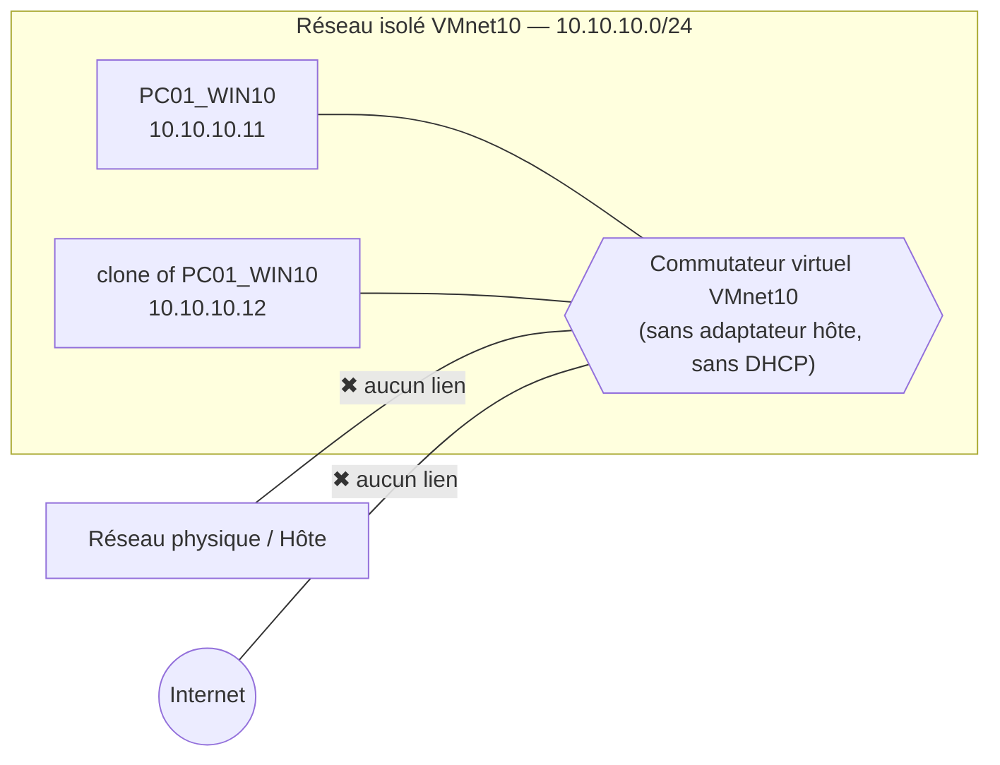

# Projet 3 — Réseau virtuel isolé (labo de test)
## 1. Contexte et objectifs

Un formateur souhaite disposer d'un **labo virtuel isolé** du réseau physique et d'Internet, afin de faire tester des configurations risquées aux étudiants sans danger pour l'infrastructure réelle.

**Objectifs :**

-  Créer un réseau virtuel interne isolé (ni Internet, ni réseau physique)
-  Connecter au moins 2 VM Windows 10 à ce réseau
-  Mettre en place, si nécessaire, une VM Windows 10 « passerelle » pour un accès contrôlé
-  Documenter les règles d'isolation appliquées
---

## 2. Architecture cible

### 2.1 Plan d'adressage

| Machine | Rôle | Carte réseau | Adresse IP | Masque | Passerelle |
|---|---|---|---|---|---|
| `PC01_WIN10` | Poste de test 1 | NIC1 → `VMnet10` | `10.10.10.11` | `255.255.255.0` | _aucune_ (phase isolée) |
| `clone of PC01_WIN10` | Poste de test 2 | NIC1 → `VMnet10` | `10.10.10.12` | `255.255.255.0` | _aucune_ (phase isolée) |
| `LAB-GW` | Passerelle (optionnelle) | NIC1 → `VMnet10` | `10.10.10.1` | `255.255.255.0` | — |
| `LAB-GW` | Passerelle (optionnelle) | NIC2 → `VMnet8` (NAT) | DHCP | — | DHCP |

- Réseau du labo : **10.10.10.0/24**
- Pas de serveur DHCP : adressage **statique** uniquement (le service DHCP de VMware est désactivé)

### 2.2 Schéma réseau




---

## 3. Prérequis

- VMware Workstation installé, lancé avec les **droits administrateur** (nécessaire pour l'éditeur de réseaux virtuels)
- 1 ISO ou 1 modèle de VM **Windows 10** (de préférence un clone lié à partir d'une VM modèle pour gagner du temps et de l'espace disque)
- Au moins 4 Go de RAM libres sur l'hôte pour 2 VM (+ 2 Go pour la passerelle)

---

## 4. Étapes de réalisation

### Étape 1 — Créer le réseau virtuel isolé

1. Dans VMware Workstation : **Edit → Virtual Network Editor**
2. Cliquer sur **Change Settings** (élévation administrateur)
3. Cliquer sur **Add Network…** → choisir **`VMnet10`** → OK
4. Sélectionner `VMnet10` et configurer :
   - Type : **Host-only**
   - ❌ **Décocher** « Connect a host virtual adapter to this network »
   - ❌ **Décocher** « Use local DHCP service to distribute IP address to VMs »
   - Subnet IP : `10.10.10.0` — Subnet mask : `255.255.255.0`
5. **Apply** puis **OK**


### Étape 2 — Préparer les VM Windows 10

Pour **chaque** VM (`PC01_WIN10`, `clone of PC01_WIN10`) :

1. **VM → Settings → Network Adapter**
2. Sélectionner **Custom: Specific virtual network** → **`VMnet10`**
3. Vérifier que l'option **Connected / Connect at power on** est cochée
4. S'assurer qu'**il n'existe aucune autre carte réseau** sur la VM (supprimer toute carte NAT/Bridged héritée du modèle)
5. Onglet **Options** (durcissement de l'isolation vers l'hôte) :
   - **Shared Folders** : *Disabled*
   - **Guest Isolation** : désactiver *Enable drag and drop* et *Enable copy and paste*


### Étape 3 — Configurer l'adressage IP

Sur chaque VM : **Paramètres → Réseau et Internet → Modifier les options d'adaptateur → Propriétés IPv4**

| VM | IP | Masque | Passerelle | DNS |
|---|---|---|---|---|
| `PC01_WIN10` | `10.10.10.11` | `255.255.255.0` | _(vide)_ | _(vide)_ |
| `clone of PC01_WIN10` | `10.10.10.12` | `255.255.255.0` | _(vide)_ | _(vide)_ |

Ou en PowerShell (administrateur) :

```powershell
# Sur PC01_WIN10 (adapter l'alias et l'IP pour clone of PC01_WIN10)
Get-NetAdapter
New-NetIPAddress -InterfaceAlias "Ethernet0" -IPAddress 10.10.10.11 -PrefixLength 24
Rename-Computer -NewName "PC01-WIN10" -Restart
```

**Autoriser le ping entre les VM** (le pare-feu Windows bloque l'ICMP par défaut) :

```powershell
New-NetFirewallRule -DisplayName "LAB - Autoriser ICMPv4 depuis le labo" `
  -Protocol ICMPv4 -IcmpType 8 -Direction Inbound `
  -RemoteAddress 10.10.10.0/24 -Action Allow
```

:::info
Si Windows classe le réseau en profil **Public**, la règle ci-dessus s'applique tout de même (elle est créée pour tous les profils par défaut). Vérifier avec `Get-NetConnectionProfile`.
:::

### Étape 4 — Tester la connectivité interne

Depuis `PC01_WIN10` :

```powershell
ipconfig /all
ping 10.10.10.12
```

Depuis `clone of PC01_WIN10` :

```powershell
ping 10.10.10.11
```

✅ **Résultat attendu :** réponses reçues (0 % de perte) dans les deux sens.


### Étape 5 — Prouver l'isolation (Internet + réseau physique)

Relever d'abord, **sur l'hôte physique**, son adresse IP et celle de la passerelle du réseau physique (`ipconfig`) — par exemple `192.168.x.x` — ainsi que le nom de la carte VMnet10 (elle ne doit **pas** apparaître).

Depuis **chaque** VM du labo :

```powershell
# 1. Internet (IP) — doit échouer
ping 8.8.8.8
ping 1.1.1.1

# 2. Internet (nom) — doit échouer
nslookup www.google.com
ping www.google.com

# 3. Hôte physique et passerelle du réseau physique — doit échouer
ping <IP-de-l-hôte-physique>
ping <IP-passerelle-réseau-physique>

# 4. Table de routage : aucune route par défaut
route print
Get-NetRoute -DestinationPrefix "0.0.0.0/0"

# 5. Test HTTP — doit échouer
Test-NetConnection -ComputerName www.google.com -Port 443
```

Sur l'**hôte physique** :

```powershell
ipconfig            # aucune interface 10.10.10.x / VMnet10 listée
ping 10.10.10.11    # doit échouer (Délai d'attente dépassé)
```

**Tableau de preuve à remplir :**

| # | Test | Source | Cible | Résultat attendu | Résultat obtenu | Capture |
|---|---|---|---|---|---|---|
| T1 | Ping interne | PC01_WIN10 | 10.10.10.12 | ✅ Succès |✅ Succès | |
| T2 | Ping interne | clone of PC01_WIN10 | 10.10.10.11 | ✅ Succès |✅ Succès | |
| T3 | Ping Internet (IP) | PC01_WIN10 | 8.8.8.8 | ❌ Échec |❌ Échec |
| T4 | Ping Internet (IP) | clone of PC01_WIN10 | 8.8.8.8 | ❌ Échec |❌ Échec ||
| T5 | Résolution DNS |PC01_WIN10 | www.google.com | ❌ Échec |❌ Échec ||
| T6 | Ping hôte physique | PC01_WIN10 | IP de l'hôte | ❌ Échec |❌ Échec ||
| T7 | Ping VM depuis l'hôte | Hôte | 10.10.10.11 | ❌ Échec |❌ Échec ||
| T8 | Interface VMnet10 sur l'hôte | Hôte | `ipconfig` | ❌ Absente |❌ Absente ||

#### 6.6 Tests de l'accès contrôlé

| # | Test | Source | Résultat attendu |
|---|---|---|---|
| G1 | `ping 10.10.10.1` | PC01_WIN10 | ✅ Succès |
| G2 | `nslookup www.google.com` |PC01_WIN10 | ✅ Résolution OK |
| G3 | Navigation HTTPS (`Test-NetConnection www.google.com -Port 443`) | PC01_WIN10 | ✅ Succès |
| G4 | `ping <IP-de-l-hôte-physique>` | PC01_WIN10 | ❌ Bloqué |
| G5 | Accès à un port non autorisé (ex. `-Port 3389` vers l'extérieur) | clone of PC01_WIN10 | ❌ Bloqué |
| G6 | **Désactiver NIC2 (SORTIE)** puis refaire G2/G3 | PC01_WIN10 | ❌ Échec (isolation rétablie) |

---

## 5. Règles d'isolation appliquées

| # | Règle | Mécanisme | Niveau | Vérification |
|---|---|---|---|---|
| R1 | Pas d'accès au réseau physique | Réseau `PC01_WIN10` de type Host-only (pas de pont) | Hyperviseur | T6 |
| R2 | Pas d'accès à Internet | Pas de NAT sur `PC01_WIN10`, pas de passerelle par défaut | Hyperviseur + IP | T3, T4, T5 |
| R3 | Hôte non joignable | Adaptateur hôte virtuel **non connecté** | Hyperviseur | T7, T8 |
| R4 | Pas de DHCP externe | Service DHCP VMware désactivé, IP statiques | Hyperviseur | `ipconfig /all` |
| R5 | Une seule carte réseau par VM cliente | Suppression des cartes NAT/Bridged | VM | Settings de chaque VM |
| R6 | Pas de canal hôte↔invité | Shared Folders, drag & drop, copier/coller désactivés | VM | Settings → Options |
| R9 | Accès sortant coupable immédiatement | NIC2 déconnectable / VM éteinte | Passerelle | G6 |

---