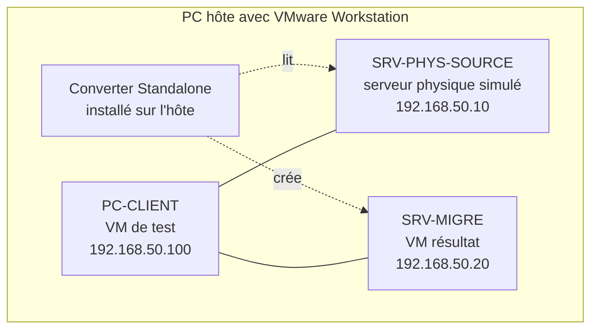

# Projet 4 — Migration d'un serveur physique vers une VM (P2V)

---

## 1. Contexte et objectifs

Une entreprise possède un **ancien serveur physique** qu'elle souhaite virtualiser pour prolonger sa durée de vie logicielle et simplifier sa maintenance.

---

## 2. Principe du P2V (à expliquer dans le rapport)

Le **P2V (Physical-to-Virtual)** consiste à copier le contenu d'une machine physique (disques, système, applications, configuration) vers une machine virtuelle équivalente.


Deux méthodes possibles :

| Méthode | Principe | Quand l'utiliser |
|---|---|---|
| **Conversion automatisée** (vCenter Converter) | Copie à chaud ou à froid du système existant | Application non réinstallable, configuration complexe |

---

## 3. Architecture du laboratoire

Comme il n'y a pas de serveur physique réel, on le **simule** avec une VM « SRV-PHYS-SOURCE » sur VMware Workstation. Elle joue le rôle du vieux serveur : elle ne recevra **pas** les VMware Tools avant la migration, afin de rester proche d'une machine physique.



| Machine | Rôle | IP | Réseau |
|---|---|---|---|
| SRV-PHYS-SOURCE | Serveur physique simulé | 192.168.50.10/24 | VMnet2 (host-only) |
| SRV-MIGRE | VM migrée (créée par Converter) | 192.168.50.20/24 | VMnet2 (host-only) |
| PC-CLIENT | Poste de test | 192.168.50.100/24 | VMnet2 (host-only) |

### Prérequis

- VMware Workstation (Pro) installé
- ISO **Windows Server 2019/2022** (version d'évaluation acceptée) — ou Ubuntu Server si vous préférez Linux
- **VMware vCenter Converter Standalone** (téléchargement depuis le portail Broadcom, compte gratuit requis)
- Espace disque libre : environ **2 × la taille du disque source**
- Ressources hôte : 16 Go de RAM recommandés

---

## 4. Étape 1 — Créer et documenter le serveur « physique » simulé

### 4.1 Créer le réseau VMnet2

1. VMware Workstation → **Edit → Virtual Network Editor** (exécuter en administrateur)
2. **Add Network → VMnet2** → type **Host-only**
3. Décocher **Use local DHCP service**
4. Subnet : `192.168.50.0` / masque `255.255.255.0`


### 4.2 Créer la VM source

1. **File → New Virtual Machine → Custom (advanced)**
2. Compatibilité matérielle : choisir une version **ancienne** (ex. Workstation 14.x) pour simuler un vieux matériel
3. Caractéristiques suggérées :

| Ressource | Valeur |
|---|---|
| vCPU | 2 |
| RAM | 4 Go |
| Disque | 60 Go, **SCSI/LSI Logic**, 2 volumes (C: système, D: données) |
| Réseau | Custom → VMnet2 |
| Nom | `SRV-PHYS-SOURCE` |

4. Installer Windows Server, nommer la machine `SRV-PHYS`, IP fixe `192.168.50.10`.


### 4.3 Donner un rôle au serveur

Choisir au minimum **deux services** à vérifier après migration :

| Service | Installation | Test |
|---|---|---|
| Serveur de fichiers | Rôle *File Server*, partage `\\SRV-PHYS\Donnees` sur D: | Accès depuis PC-CLIENT |
| Serveur web | Rôle *IIS*, page `index.html` personnalisée | `http://192.168.50.10` |
| (option) DNS / AD / base de données | selon votre choix | requête de test |

Créer sur D: des **données de test** : 20 à 50 fichiers de tailles variées, dont un fichier de **checksum connu**.

### 4.4 Fiche d'identité du serveur source

Relever et noter dans la section « Comparatif » (§9) :

```powershell
# Informations système
systeminfo
Get-ComputerInfo | Select CsName, OsName, OsVersion, CsProcessors, CsTotalPhysicalMemory

# Disques et volumes
Get-Disk
Get-Volume

# Réseau
ipconfig /all
Get-NetAdapter | Select Name, MacAddress, LinkSpeed

# Services et rôles
Get-WindowsFeature | Where Installed
Get-Service | Where Status -eq Running

# Activation Windows
slmgr /dlv
```

```powershell
# Checksums des données de test (à comparer après migration)
Get-FileHash D:\Donnees\* -Algorithm SHA256 | Export-Csv C:\avant_hash.csv -NoTypeInformation
```


### 4.5 Mesurer les performances de référence (« avant »)

| Test | Outil | Résultat à noter |
|---|---|---|
| Disque séquentiel / aléatoire | CrystalDiskMark ou `winsat disk` | 244.19 Mo/s, IOPS |
| Temps de boot | Chronomètre (du démarrage à l'écran de login) | 20 secondes |
| Copie d'un gros fichier (2 Go) depuis PC-CLIENT | Chronomètre | 5 secondes |
| Temps de réponse web | `Measure-Command { Invoke-WebRequest http://192.168.50.10 }` | 144 ms |
| Charge CPU/RAM au repos | Gestionnaire des tâches | 10-15% |

---

## 5. Étape 2 — Choisir et justifier l'outil de migration

| Outil | Avantages | Inconvénients |
|---|---|---|
| **VMware vCenter Converter Standalone** | Gratuit, intégré à l'écosystème VMware, conversion à chaud, ajustement des disques | Plus mis à jour régulièrement, téléchargement via Broadcom |
| Disk2vhd + conversion (`qemu-img`) | Simple, pas d'agent | Conversion manuelle, plus de travail post-migration |
| Clonezilla / image disque | Fonctionne à froid, tous OS | Étapes manuelles, pilotes à gérer |
| Reconstruction manuelle | Système propre | Réinstallation et reconfiguration complètes |

**Choix retenu : VMware vCenter Converter Standalone.**
À justifier dans le rapport (gratuit, adapté à Workstation, démarche P2V standard, documentation abondante).

---

## 6. Étape 3 — Préparer la migration

### 6.1 Checklist avant migration

-  Snapshot de la VM source (point de retour) : `Avant-P2V`

-  Sauvegarde des données importantes
-  Source allumée, joignable depuis l'hôte (`ping 192.168.50.10`)

-  Compte **Administrateur** local avec mot de passe connu
-  Pare-feu de la source : autoriser **Partage de fichiers et d'imprimantes** (SMB)
-  Espace disque suffisant sur l'hôte
-  Documentation « avant » terminée

### 6.2 Préparer la source pour un accès distant

Sur **SRV-PHYS-SOURCE** :

```powershell
# Autoriser le partage admin et l'accès distant avec compte local
Set-ItemProperty -Path HKLM:\SOFTWARE\Microsoft\Windows\CurrentVersion\Policies\System `
  -Name LocalAccountTokenFilterPolicy -Value 1 -Type DWord

# Règles de pare-feu
Enable-NetFirewallRule -DisplayGroup "File and Printer Sharing"
```

Depuis l'hôte, vérifier l'accès : `\\192.168.50.10\C$`

### 6.3 Installer Converter sur l'hôte

1. Lancer l'installateur **VMware vCenter Converter Standalone**
2. Choisir **Local installation**
3. Terminer l'assistant avec les options par défaut

---

## 7. Étape 4 — Réaliser la migration

### 7.1 Lancer l'assistant

1. Ouvrir **VMware vCenter Converter Standalone**
2. Cliquer sur **Convert machine**

### 7.2 Source System

| Champ | Valeur |
|---|---|
| Select source type | **Powered-on machine** |
| Specify the powered-on machine | **A remote machine** |
| Server | `192.168.50.10` |
| User name | `Administrator` |
| Password | (mot de passe) |
| OS Family | Windows |

→ **Next**, puis accepter l'installation de l'agent Converter sur la source (**Automatically uninstall the files when import succeeds**).

### 7.3 Destination System

| Champ | Valeur |
|---|---|
| Select destination type | **VMware Workstation or other VMware virtual machine** |
| Select VMware product | VMware Workstation 17.x (ou votre version) |
| Name | `SRV-MIGRE` |
| Select a location | Dossier local de l'hôte (ex. `D:\VMs\SRV-MIGRE`) |

### 7.4 Options (étape clé)

| Paramètre | Choix |
|---|---|
| **Data to copy** | Tous les volumes (C: et D:) ; type de disque **Thin** pour économiser l'espace |
| **Devices** | 2 vCPU, 4 Go RAM (ou ajuster) |
| **Networks** | Carte réseau connectée à **VMnet2** |
| **Services** | Arrêter les services applicatifs pendant la copie pour garantir la cohérence |
| **Advanced → Post-conversion** | Cocher **Install VMware Tools on the destination VM** |
| **Advanced → Post-conversion** | Cocher **Reconfigure destination virtual machine** |
| **Advanced → Post-conversion** | Cocher **Remove System Restore checkpoints** |

### 7.5 Lancer et suivre

1. **Next → Finish**
2. Suivre la progression dans la fenêtre *Task* (statut, pourcentage, durée)
3. Noter la **durée totale** de la conversion et la **taille du VMDK** obtenu
4. Statut final attendu : **Completed**

### 7.6 Premier démarrage de la VM migrée

1. **Éteindre SRV-PHYS-SOURCE** (ou changer son IP)
2. Ouvrir `SRV-MIGRE` dans VMware Workstation : **File → Open → fichier .vmx**
3. Allumer la VM → au prompt « I moved it / I copied it », choisir **I copied it** (nouvelle identité et nouvelle MAC)
4. Se connecter, vérifier l'installation des **VMware Tools** (redémarrer si demandé)


---

## 8. Étape 5 — Corrections post-migration

À traiter dans cet ordre :

| # | Action | Commande / méthode |
|---|---|---|
| 1 | Vérifier **VMware Tools** | `Get-Service VMTools` ; sinon VM → Install VMware Tools |
| 2 | Supprimer les **cartes réseau fantômes** | `set devmgr_show_nonpresent_devices=1` puis `devmgmt.msc` → Afficher les périphériques cachés |
| 3 | Reconfigurer l'**IP statique** (la nouvelle carte perd la config) | `192.168.50.20/24` |
| 4 | Vérifier les **services** | `Get-Service \| Where Status -eq Running` |
| 5 | Vérifier l'**activation Windows** | `slmgr /dlv` ; réactiver si besoin |
| 6 | Désinstaller les **outils constructeur** inutiles (agents matériel, pilotes RAID, etc.) | Programmes et fonctionnalités |
| 7 | Vérifier **disques et lettres de lecteur** | `Get-Volume` |
| 8 | Vérifier les **journaux d'événements** | `eventvwr.msc` → erreurs au démarrage |

---

## 8. Étape 7 — Problèmes rencontrés

### Problèmes fréquents

| Symptôme | Cause probable | Solution |
|---|---|---|
| Converter ne se connecte pas à la source | Pare-feu / UAC distant |  : `LocalAccountTokenFilterPolicy`, règle SMB |
| Erreur « Unable to contact the specified host » | Mauvaise IP / VMnet | Vérifier `ping` et que source et hôte sont sur VMnet2 |
| Échec à 1 % ou 98 % | Pas assez d'espace, antivirus, service VSS | Libérer de l'espace, désactiver l'antivirus, vérifier le service VSS |
| Écran bleu `INACCESSIBLE_BOOT_DEVICE` | Pilote du contrôleur disque absent | Option *Reconfigure* ; adapter le type de contrôleur dans les paramètres VM |
| Pas de réseau après migration | Nouvelle carte, IP perdue | Reconfigurer l'IP, supprimer les cartes fantômes |
| Windows demande l'activation | Matériel détecté comme différent | Réactiver avec la clé d'origine |
| Lenteur au boot | Services liés au matériel physique en échec | Désactiver les services inutiles (RAID, agents constructeur) |
| Conflit d'IP | Source et VM migrée allumées ensemble | Éteindre l'une ou changer l'IP |

---

## 9. Étape 8 — Rapport de migration

### 9.1 Matrice des risques et limites

| Domaine | Risque | Probabilité | Impact | Mesure de réduction |
|---|---|---|---|---|
| **Pilotes** | Contrôleur disque ou carte réseau non reconnus → pas de démarrage | Moyenne | Élevé | Option *Reconfigure*, tests à froid, pilotes injectés |
| **Pilotes** | Outils et agents constructeur inutiles qui échouent | Élevée | Faible | Désinstallation après migration |
| **Licences** | Réactivation Windows requise (changement matériel) | Élevée | Moyen | Vérifier le type de licence (OEM / Retail / Volume) avant migration |
| **Licences** | Logiciel lié à l'adresse MAC ou à un dongle USB | Moyenne | Élevé | Inventaire des logiciels, contacter l'éditeur, passthrough USB |
| **Licences** | Licence OEM non transférable en VM | Moyenne | Élevé | Vérification contractuelle |
| **Performances** | Écart de performance disque/réseau | Moyenne | Moyen | PVSCSI/VMXNET3, VMware Tools, dimensionnement |
| **Performances** | Surallocation de ressources sur l'hôte | Moyenne | Moyen | Suivi CPU/RAM de l'hôte |
| **Cohérence des données** | Copie à chaud d'une base de données incohérente | Moyenne | Élevé | Arrêt des services ou copie à froid ; vérification des hashes |
| **Disponibilité** | Interruption pendant la bascule | Élevée | Moyen | Fenêtre de maintenance planifiée |
| **Réseau** | Conflit d'IP / MAC, DNS obsolète | Moyenne | Moyen | Plan d'adressage, mise à jour DNS |
| **Sécurité** | Système ancien, non patché, repris tel quel | Élevée | Élevé | Mises à jour, isolation réseau, plan de renouvellement |
| **Sécurité** | VMDK = copie complète des données, à protéger | Moyenne | Élevé | Droits d'accès, chiffrement, suppression des copies temporaires |
| **Matériel dédié** | Cartes spécifiques (RAID, PCI, série) non virtualisables | Faible | Élevé | Inventaire matériel avant migration |
| **Support** | OS en fin de vie, non supporté en VM | Moyenne | Moyen | Plan de migration vers un OS supporté |
| **Retour arrière** | Impossible de revenir à l'état initial | Faible | Élevé | Conserver le serveur source intact pendant la période de test |

### 9.2 Limites du P2V (à développer)

- Le P2V **copie les problèmes** du système source (configuration fragile, vieux logiciels, failles).
- Le comportement n'est **pas toujours identique** : matériel virtuel différent (contrôleurs, cartes réseau, horloge).
- Les périphériques **spécifiques** (dongle USB, carte série, GPU) nécessitent des solutions dédiées.
- Les **licences** peuvent interdire ou restreindre la virtualisation.
- La migration **à chaud** peut produire des données incohérentes (bases de données).
- Le temps de conversion dépend de la **taille des disques** et du **réseau**.
- Dans ce labo, la source est **simulée** : elle ne reproduit pas tous les problèmes d'un vrai matériel (pilotes RAID propriétaires, BIOS spécifique, etc.).

### 9.3 Plan de retour arrière

1. Conserver **SRV-PHYS-SOURCE** intact (éteinte, snapshot `Avant-P2V` conservé)
2. Si un test critique échoue : éteindre `SRV-MIGRE`, rallumer la source
3. Rétablir l'IP d'origine, informer les utilisateurs
4. Ne supprimer la source qu'après une **période de validation** (par ex. 2 semaines)


---

## 10. Annexes

### Commandes utiles

```powershell
# Vérifier le matériel vu par Windows
Get-PnpDevice | Where Status -ne OK

# Disques
Get-PhysicalDisk | Select FriendlyName, MediaType, Size

# Temps de démarrage
(Get-CimInstance Win32_OperatingSystem).LastBootUpTime

# Performance rapide du disque
winsat disk -drive c
```